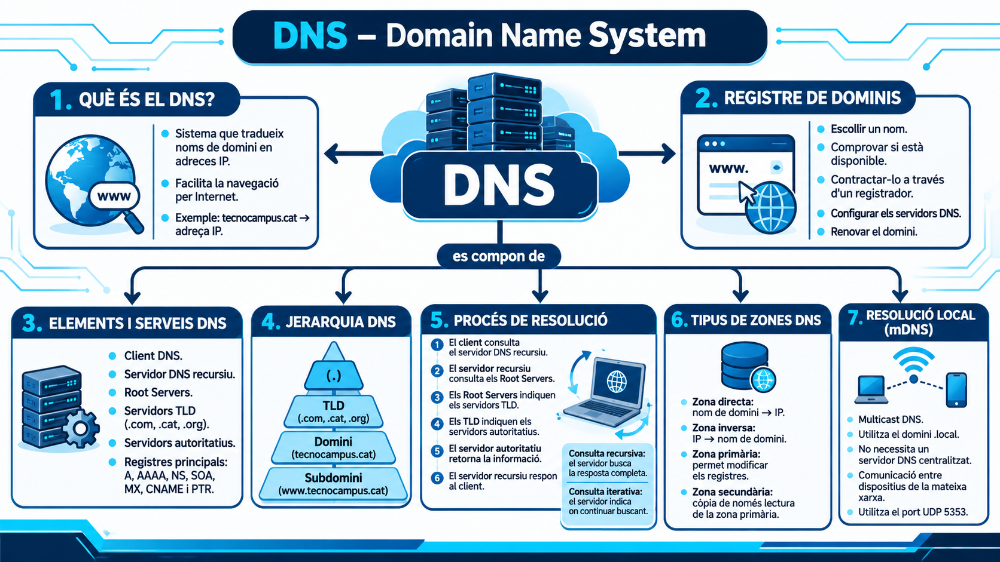

# PROJECTE DE CONSULTORIA DNS – TECHCLOUD SOLUTIONS

**Client:** Innovació Tecnològica del Maresme S.L.  
**Empresa:** TechCloud Solutions  
**Alumne:** Biel Clave Navarro  
**Mòdul:** Serveis en Xarxa  
**Activitat:** AA1 – Diagnosi DNS  
**Sistema operatiu:** Zorin OS  

---

# 1. INTRODUCCIÓ

En aquesta activitat treballarem el funcionament del servei DNS en un entorn Linux utilitzant una màquina virtual amb Zorin OS.

L'objectiu és comprovar com funciona la resolució de noms de domini, analitzar diferents registres DNS i verificar la comunicació entre equips d'una mateixa xarxa local.

Per fer les proves utilitzarem eines de terminal com `dig`, `nslookup`, `ping` i `hostname`.

# 2. PART TEÒRICA: FUNCIONAMENT DEL DNS

## 2.1. Què és el DNS?

El DNS (Domain Name System) és un sistema que s'encarrega de traduir els noms de domini en adreces IP.

Això permet que els usuaris puguin accedir a pàgines web utilitzant noms fàcils de recordar en comptes de memoritzar adreces IP.

**Exemple:**
- Nom de domini: google.com
- Adreça IP: IP associada al servidor de Google.

Sense el DNS, hauríem d'introduir directament les adreces IP per accedir als diferents serveis d'Internet.

## 2.2. Com contractar un nom de domini?

Per tenir un domini propi, primer s'ha de comprovar que estigui disponible i després registrar-lo a través d'una empresa registradora.

El procés habitual és:

1. Escollir un nom de domini.
2. Comprovar si està disponible.
3. Contractar-lo mitjançant un registrador de dominis.
4. Configurar els servidors DNS corresponents.
5. Renovar el domini quan sigui necessari.

Un domini registrat permet tenir una adreça pròpia a Internet, com per exemple una pàgina web o un servei de correu electrònic.

## 2.3. Elements i serveis d'un DNS

El DNS està format per diferents elements que treballen conjuntament:

- **Client DNS:** Dispositiu que necessita resoldre un nom de domini.
- **Servidor DNS recursiu:** Rep les consultes dels clients i busca la resposta.
- **Root Servers:** Servidors arrel que indiquen on trobar els servidors dels dominis de nivell superior.
- **Servidors TLD:** Gestionen extensions com .cat, .com, .org o .net.
- **Servidors autoritatius:** Contenen la informació oficial dels dominis.

També existeixen diferents registres DNS:

- **A:** Relaciona un domini amb una adreça IPv4.
- **AAAA:** Relaciona un domini amb una adreça IPv6.
- **NS:** Indica els servidors de noms del domini.
- **SOA:** Conté informació administrativa de la zona DNS.
- **MX:** Indica els servidors de correu electrònic.
- **CNAME:** Crea un àlies que apunta a un altre nom de domini.
- **PTR:** Permet fer resolucions inverses d'adreces IP.

## 2.4. Jerarquia i estructura DNS

El DNS té una estructura en forma d'arbre, organitzada per diferents nivells.

Els principals nivells són:

1. **Arrel (.):** És el nivell superior del sistema DNS.
2. **Dominis de nivell superior (TLD):** Extensions com .com, .cat, .org o .net.
3. **Domini de segon nivell:** És el nom que es registra, com tecnocampus.cat.
4. **Subdominis:** Noms que depenen d'un domini principal, com www.tecnocampus.cat.

Aquesta estructura permet organitzar milions de dominis de manera ordenada.

## 2.5. Procés de resolució DNS

Quan escrivim un domini al navegador, l'ordinador necessita trobar la seva adreça IP.

El procés habitual és:

1. El client comprova si té la resposta guardada a la memòria cau.
2. Si no la té, consulta el servidor DNS recursiu.
3. El servidor recursiu consulta els servidors arrel.
4. Els servidors arrel indiquen on trobar els servidors TLD.
5. El servidor TLD indica quin és el servidor autoritatiu.
6. El servidor autoritatiu proporciona la resposta.
7. El servidor recursiu retorna l'adreça IP al client.

**Consultes recursives:**

El client demana una resposta completa al servidor DNS. Aquest s'encarrega de buscar-la i retornar el resultat.

**Consultes iteratives:**

El servidor consultat pot indicar quin altre servidor s'ha de consultar per continuar la cerca fins a trobar la resposta.

Els Root Servers ajuden a trobar els servidors TLD, mentre que els servidors autoritatius contenen la informació oficial del domini.

## 2.6. Tipus de zones DNS

Hi ha diferents tipus de zones segons la informació que contenen i com es gestionen.

**Zona directa (Forward Lookup):**

Permet transformar un nom de domini en una adreça IP. Per exemple, tecnocampus.cat cap a una IP.

**Zona inversa (Reverse Lookup):**

Permet fer el procés contrari, és a dir, trobar el nom de domini a partir d'una adreça IP.

**Zona primària:**

És la zona principal on es poden modificar els registres DNS.

**Zona secundària:**

És una còpia de només lectura de la zona primària, que serveix per tenir redundància i disponibilitat.

## 2.7. Resolució local i protocol mDNS

El protocol mDNS (Multicast DNS) permet resoldre noms de dispositius dins d'una mateixa xarxa local sense necessitar un servidor DNS centralitzat.

Utilitza el domini especial `.local` i envia consultes multicast perquè els altres dispositius de la xarxa puguin respondre.

Utilitza el port **UDP 5353**.

El seu principal avantatge és que facilita la comunicació entre dispositius d'una xarxa local sense haver de configurar manualment un servidor DNS.

---

# 3. PART PRÀCTICA: AUDITORIA DNS

## 3.1. Configuració de l'entorn de treball

Per fer les proves utilitzarem una màquina virtual amb Zorin OS.

La configuració de xarxa demanada és:

- **Interfície 1 (NAT):** Permet tenir accés a Internet.
- **Interfície 2 (Adaptador pont / Bridged):** Permet comunicar-se amb altres dispositius de la xarxa local.

Per comprovar les interfícies de xarxa executem la següent comanda:

```bash
ip a
```

**Resultats obtinguts:**

- IP de la interfície NAT: [ESCRIURE IP]
- IP de la interfície Bridged: [ESCRIURE IP]
- Nom de les interfícies: [ESCRIURE NOMS]
- Estat de les interfícies: [ESCRIURE ESTAT]

**Anàlisi:**

Amb aquesta comanda podem veure les interfícies de xarxa disponibles, les seves adreces IP i el seu estat.

La interfície NAT ens permet tenir sortida a Internet i la interfície Bridged permet connectar la màquina virtual amb altres dispositius de la xarxa local.

**Captura de pantalla:**


---

# 4. PART A: DIAGNOSI AVANÇADA AMB DIG

Per fer les consultes utilitzarem el domini `tecnocampus.cat` i l'eina `dig`, que permet consultar diferents tipus de registres DNS.

## 4.1. Comanda 1: consulta bàsica del registre A

**Comanda executada:**

```bash
dig tecnocampus.cat A
```

**Què comprovem?**

El registre A permet obtenir l'adreça IPv4 associada a un nom de domini.

**Resultats obtinguts:**

- Adreça IP: [ESCRIURE IP]
- TTL: [ESCRIURE TTL]
- Servidor DNS que ha respost: [ESCRIURE IP DEL SERVIDOR]
- Temps de consulta: [ESCRIURE TEMPS]

**Anàlisi:**

La consulta ens mostra quina adreça IPv4 està associada al domini tecnocampus.cat.

El TTL (Time To Live) indica durant quant temps es pot mantenir la resposta a la memòria cau abans de tornar-la a consultar.

El servidor DNS que ha respost es pot identificar a la part final de la sortida de `dig`, a l'apartat SERVER.

El temps de consulta indica quant ha trigat el servidor a respondre.

**Captura de pantalla:**


## 4.2. Comanda 2: consulta dels servidors de noms NS

**Comanda executada:**

```bash
dig tecnocampus.cat NS
```

**Què comprovem?**

El registre NS indica quins servidors DNS són responsables de gestionar la informació del domini.

**Resultats obtinguts:**

- Primer servidor NS: [ESCRIURE SERVIDOR]
- Segon servidor NS: [ESCRIURE SERVIDOR]
- Altres servidors NS: [ESCRIURE SI N'HI HA]

**Anàlisi:**

Amb aquesta consulta podem identificar els servidors de noms autoritatius del domini tecnocampus.cat.

Aquests servidors són els responsables de proporcionar la informació oficial dels registres del domini.

**Captura de pantalla:**


## 4.3. Comanda 3: consulta del registre SOA

**Comanda executada:**

```bash
dig tecnocampus.cat SOA
```

**Què comprovem?**

El registre SOA (Start of Authority) conté informació administrativa i tècnica sobre la zona DNS.

**Resultats obtinguts:**

- Servidor principal (MNAME): [ESCRIURE SERVIDOR]
- Correu de l'administrador (RNAME): [ESCRIURE CORREU]
- Número de sèrie (SERIAL): [ESCRIURE NÚMERO]
- Refresh: [ESCRIURE VALOR]
- Retry: [ESCRIURE VALOR]
- Expire: [ESCRIURE VALOR]

**Anàlisi:**

El registre SOA permet identificar el servidor DNS principal de la zona, el correu de contacte de l'administrador i el número de sèrie.

El número de sèrie serveix per identificar la versió de la zona DNS i comprovar si s'han produït canvis.

El valor MNAME identifica el servidor DNS principal i el RNAME indica el correu de contacte de l'administrador. Aquest últim apareix amb un format especial de DNS.

Els valors Refresh, Retry i Expire controlen diferents intervals de sincronització entre servidors DNS.

**Captura de pantalla:**


## 4.4. Comanda 4: consulta de resolució inversa PTR

**Comanda executada:**

```bash
dig -x [IP OBTINGUDA A LA COMANDA 1]
```

**Què comprovem?**

La resolució inversa permet obtenir un nom de domini a partir d'una adreça IP.

Utilitza el registre PTR, que relaciona una IP amb un nom de domini.

**Resultats obtinguts:**

- IP consultada: [ESCRIURE IP]
- Nom de domini obtingut: [ESCRIURE RESULTAT]
- Registre trobat: [ESCRIURE PTR O INDICAR SI NO N'HI HA]

**Anàlisi:**

Amb aquesta comanda comprovem si l'adreça IP obtinguda anteriorment té associat un nom de domini mitjançant un registre PTR.

Si apareix un registre PTR, podem veure a quin nom de domini correspon aquella IP.

Si no apareix cap resultat PTR, significa que no s'ha trobat una resolució inversa per aquella IP.

**Captura de pantalla:**


---

# 5. PART B: COMPROVACIÓ AMB NSLOOKUP

En aquesta part utilitzarem l'eina `nslookup`, que permet consultar informació DNS des de la terminal.

Primer iniciem el mode interactiu:

```bash
nslookup
```

Un cop apareix el símbol `>`, podem introduir diferents ordres.

Les ordres principals són:

- `set type=A`: Selecciona el tipus de registre que volem consultar.
- `server IP`: Canvia el servidor DNS utilitzat.
- `exit`: Surt del mode interactiu.

## 5.1. Comanda 5: consulta bàsica no autoritativa

**Comandes executades dins de nslookup:**

```bash
set type=A
tecnocampus.cat
```

**Què comprovem?**

Fem una consulta del registre A per obtenir l'adreça IP del domini tecnocampus.cat.

**Resultats obtinguts:**

- Servidor DNS utilitzat: [ESCRIURE SERVIDOR]
- Adreça IP obtinguda: [ESCRIURE IP]
- Tipus de resposta: [AUTORITATIVA / NO AUTORITATIVA]

**Anàlisi:**

La resposta apareix com a *Non-authoritative answer* perquè el servidor DNS que hem consultat no és el servidor autoritatiu del domini.

Normalment és un servidor DNS recursiu que ja té la resposta guardada a la memòria cau o que l'ha obtingut consultant altres servidors.

Això no significa que la resposta sigui incorrecta, sinó que no prové directament del servidor autoritatiu.

**Captura de pantalla:**


## 5.2. Comanda 6: consulta directa al servidor autoritatiu

Primer canviem el servidor DNS pel primer servidor autoritatiu que hem trobat a la consulta NS.

**Comanda executada dins de nslookup:**

```bash
server [NOM O IP DEL SERVIDOR AUTORITATIU]
```

Si utilitzem el nom del servidor i no funciona, podem consultar la seva IP amb:

```bash
dig +short A [NOM DEL SERVIDOR NS]
```

Després tornem a fer la consulta:

```bash
set type=A
tecnocampus.cat
```

**Resultats obtinguts:**

- Servidor autoritatiu utilitzat: [ESCRIURE SERVIDOR]
- Adreça IP obtinguda: [ESCRIURE IP]
- Tipus de resposta: [AUTORITATIVA / NO AUTORITATIVA]

**Anàlisi:**

En aquesta prova consultem directament un dels servidors autoritatius del domini.

Si la consulta es realitza correctament i obtenim una resposta autoritativa, hauria de desaparèixer l'indicador *Non-authoritative answer*.

Això confirma que estem consultant directament un servidor responsable de la informació del domini.

Les respostes haurien de ser coherents amb les de la consulta anterior, encara que el TTL pot ser diferent.

Si no funciona, cal comprovar que el servidor seleccionat sigui accessible i que accepti consultes DNS directes.

**Captura de pantalla:**


Per sortir del mode interactiu utilitzem:

```bash
exit
```

---

# 6. PART C: RESOLUCIÓ LOCAL I PROTOCOL mDNS

En aquesta part comprovarem si podem comunicar-nos amb altres dispositius de la mateixa xarxa local utilitzant el protocol mDNS.

## 6.1. Comprovació del hostname

Primer consultem el nom de la nostra màquina Zorin OS.

**Comanda executada:**

```bash
hostname
```

**Resultat obtingut:**

- Nom de la màquina: [ESCRIURE HOSTNAME]

**Anàlisi:**

La comanda `hostname` mostra el nom assignat al nostre ordinador dins de la xarxa.

Aquest nom ens servirà per fer la prova de resolució local amb mDNS.

**Captura de pantalla:**


## 6.2. Prova de resolució mDNS

Des d'un altre equip connectat a la mateixa xarxa local, executem la següent comanda substituint el nom pel hostname obtingut anteriorment:

**Comanda executada:**

```bash
ping [HOSTNAME].local
```

Per aturar el ping podem utilitzar `Ctrl + C`.

**Resultats obtinguts:**

- Hostname consultat: [ESCRIURE HOSTNAME]
- Resposta obtinguda: [INDICAR SI FUNCIONA O NO]
- Adreça IP resolta: [ESCRIURE IP]
- Paquets rebuts: [ESCRIURE RESULTAT]

**Anàlisi:**

Amb aquesta prova comprovem si un altre dispositiu pot trobar la nostra màquina utilitzant el seu nom acabat en `.local`.

El protocol mDNS envia consultes multicast a la xarxa local utilitzant el port UDP 5353.

Quan un dispositiu rep una consulta amb el seu nom, pot respondre indicant la seva adreça IP.

Això permet que els dispositius es puguin descobrir i comunicar sense necessitat de tenir un servidor DNS centralitzat.

Si la prova no funciona, pot ser per problemes de configuració de mDNS, del tallafoc o de la connexió entre els equips.

**Captura de pantalla:**


---

## Mapa conceptual del DNS

A continuació es mostra un mapa conceptual que resumeix visualment el funcionament del servei DNS. Hi podem veure els seus elements principals, l'estructura jeràrquica, els tipus de registres, el procés de resolució de noms i el funcionament del mDNS.



Aquest esquema permet entendre d'una manera més visual com treballa el DNS i com es relacionen els diferents elements que intervenen en la resolució dels noms de domini.

# 7. CONCLUSIONS

Amb aquesta activitat hem pogut conèixer millor el funcionament del servei DNS i la seva importància dins d'una xarxa informàtica.

Hem utilitzat diferents eines de terminal per consultar registres A, NS, SOA i PTR, així com per comprovar les respostes autoritatives i no autoritatives.

També hem pogut comprovar el funcionament de la resolució local mitjançant el protocol mDNS.

Aquestes proves ens permeten entendre millor com es resolen els noms de domini i com podem detectar possibles problemes de configuració DNS en una xarxa.

**Valoració personal:**

Aquesta pràctica m'ha servit per aprendre a utilitzar eines com `dig` i `nslookup`, que són útils per comprovar si un domini es resol correctament. També he après la diferència entre una consulta autoritativa i una no autoritativa i com funciona la resolució de noms dins d'una xarxa local.

---

# 8. FONTS I EINES CONSULTADES

Per realitzar aquesta activitat he utilitzat les següents eines i recursos:

### Intel·ligència artificial

**Eina utilitzada:** ChatGPT (OpenAI).

He utilitzat la intel·ligència artificial com a eina de suport per:

- Organitzar l'estructura del document Markdown.
- Entendre els conceptes teòrics relacionats amb el DNS.
- Conèixer la funció de les diferents comandes de terminal.
- Preparar les explicacions i l'anàlisi dels resultats.
- Resoldre dubtes sobre com documentar les proves.
- Fer l'estructura del video i el mapa conceptual.

Les comandes, les proves pràctiques, les captures de pantalla i els resultats s'han d'obtenir i comprovar al meu propi entorn de treball.

**Enllaç a la conversa amb la IA sobre el codi:** [https://chatgpt.com/share/6af358ac-8a54-83ed-9487-e54e528b061d]

**Enllaç de la conversa sobre el mapa conceptual** [https://chatgpt.com/share/6af357f0-9fa8-83eb-9dac-3615b8e8a0be]

**Enllaç de la conversa sobre el guio del video** [https://chatgpt.com/share/6af35942-5f8c-83eb-bd42-9e6c098d0f46]

### Altres eines utilitzades

- **Terminal de Zorin OS:** Per executar les comandes i obtenir els resultats reals de les proves.
- **Visual Studio Code:** Per crear i editar el document Markdown.
- **GitHub:** Per guardar i visualitzar la documentació.

---

**FINAL DEL DOCUMENT**
