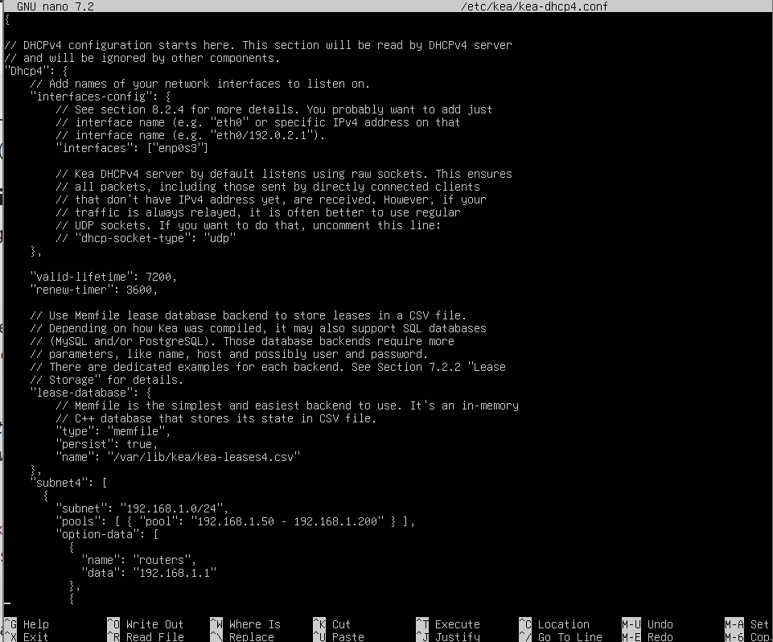
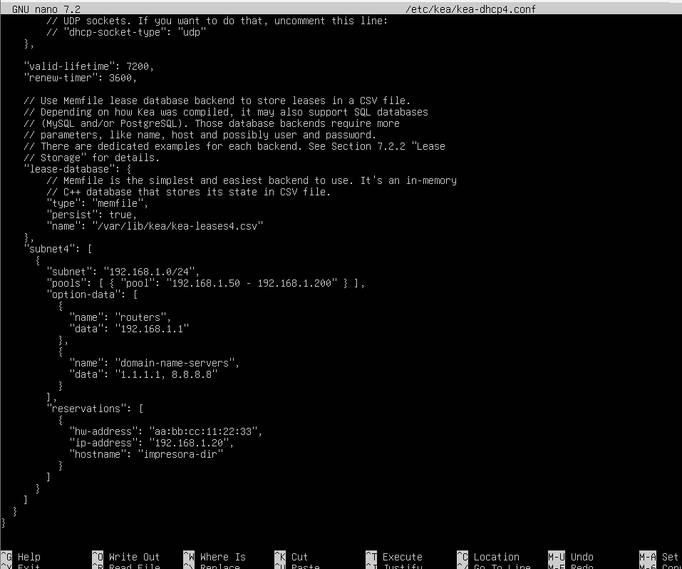
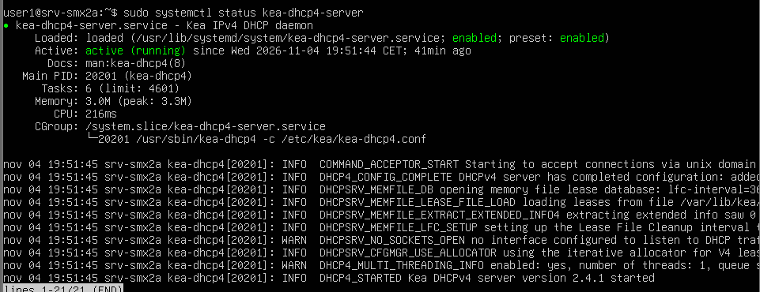
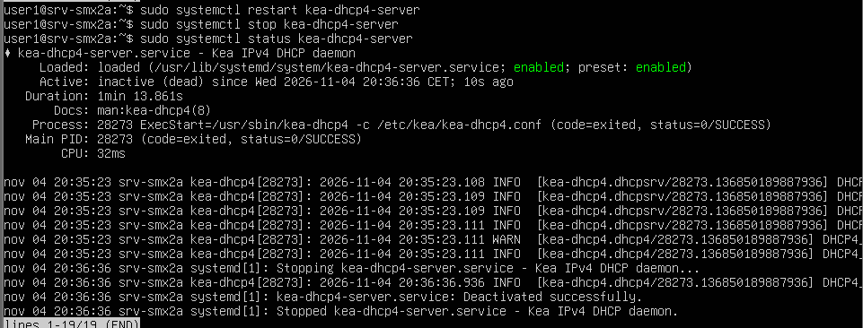
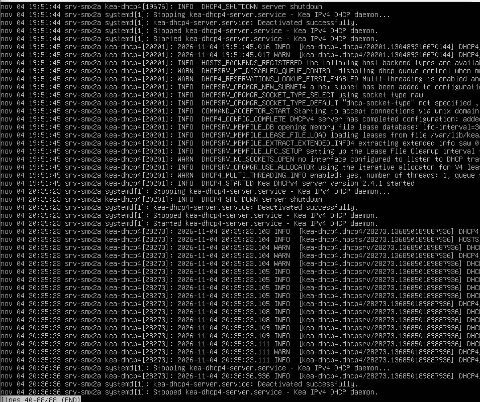
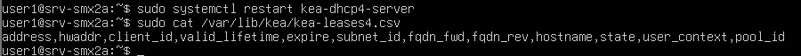
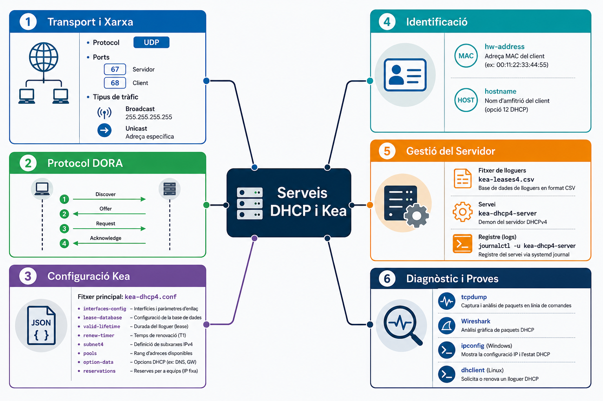

# AA2 – Avaluació: Anàlisi Kea DHCP

**Mòdul:** M0227 – Serveis de Xarxa  
**Alumne:** Biel Clave   
**Curs:** SMX2  
**Empresa:** TechMataró SL  
**Data:**  04/11/2026

---

# 1. Introducció

En aquesta activitat es treballarà la instal·lació, configuració i gestió del servei Kea DHCP4 en un sistema Linux. L'objectiu és aprendre a configurar l'adreçament IP dinàmic, crear reserves d'adreces IP i comprovar el funcionament del servidor mitjançant diferents eines de diagnòstic.

L'activitat es desenvolupa en l'escenari d'una empresa anomenada TechMataró SL, que necessita un servidor DHCP per gestionar les adreces IP dels seus dispositius.

---

# 2. Bloc 1 – Fonaments del protocol i anàlisi de tràfic

## 2.1 Procés de negociació DHCP (DORA)

El procés DORA és el procediment que segueix un client per obtenir una adreça IP automàticament.

- **Discover:** el client busca un servidor DHCP disponible.
- **Offer:** el servidor ofereix una adreça IP al client.
- **Request:** el client sol·licita l'adreça IP que vol utilitzar.
- **Acknowledge:** el servidor confirma l'assignació de l'adreça IP.

### Broadcast i Unicast

Indicar quines fases del procés DORA utilitzen Broadcast i quines Unicast en una xarxa local sense DHCP Relay.

**Resposta:**
 - Discover: Broadcast, perquè el client busca servidors DHCP disponibles.
 - Offer: Broadcast o Unicast, segons les condicions de comunicació.
 - Request: Broadcast, perquè el client comunica quin servidor ha seleccionat.
 - Acknowledge: Broadcast o Unicast, segons les condicions de recepció del client

## 2.2 Ports i capçaleres DHCP

DHCP utilitza el protocol UDP per comunicar el client amb el servidor.

- Port UDP del client: 68
- Port UDP del servidor: 67

### Identificació del client

Indicar quin camp de la capçalera DHCP permet identificar la targeta de xarxa del client.

**Resposta:** El camp és chaddr (Client Hardware Address), que conté l'adreça MAC de la targeta de xarxa del client.


---

# 3. Bloc 2 – Configuració del servidor Kea DHCP

## 3.1 Configuració de la interfície i base de dades

El servidor Kea DHCP4 s'ha de configurar perquè escolti les peticions DHCP a través de la interfície de xarxa `eth0`.

També s'ha d'utilitzar el sistema d'emmagatzematge `memfile` per guardar les cessions DHCP, amb persistència activada.

## 3.2 Paràmetres globals i temps de cessió

Configurar els següents paràmetres:

| Paràmetre | Valor |
|---|---|
| `valid-lifetime` | 7200 segons |
| `renew-timer` | 3600 segons |

## 3.3 Configuració de la subxarxa i pool

La xarxa de l'empresa utilitza una subxarxa `192.168.x.0/24`.

El servidor ha de permetre l'assignació dinàmica d'adreces IP dins del següent rang:

- **Subxarxa:** `192.168.1.0/24`
- **Pool dinàmic:** `192.168.1.50` – `192.168.1.200`

## 3.4 Opcions de xarxa

Configurar les opcions necessàries perquè els clients rebin correctament els paràmetres de xarxa.

| Paràmetre | Valor |
|---|---|
| Router | `192.168.x.1` |
| DNS primari | `1.1.1.1` |
| DNS secundari | `8.8.8.8` |
| Domini local | `oficina.local` |

## 3.5 Fitxer de configuració `kea-dhcp4.conf`

Redactar el fitxer JSON complet amb tots els paràmetres anteriors.

```json
// Configuració del servidor Kea DHCP4
```

### Evidència pràctica

Afegir una captura del fitxer de configuració obert a la terminal o editor.

**Captura:** 





---

# 4. Bloc 3 – Assignació estàtica i reserves MAC

## 4.1 Configuració de la reserva

Per garantir que la impressora de l'oficina sempre rebi la mateixa adreça IP, s'ha de crear una reserva DHCP associada a la seva adreça MAC.

Els paràmetres de la reserva són:

| Paràmetre | Valor |
|---|---|
| `hw-address` | `aa:bb:cc:11:22:33` |
| Adreça IP | `192.168.x.20` |
| `hostname` | `impresora-dir` |

Afegir la configuració de la reserva dins de la secció corresponent de la subxarxa.

```json
// Configuració de la reserva DHCP
```

## 4.2 Validació de la sintaxi

Abans d'iniciar el servei, cal comprovar que el fitxer JSON no conté errors de sintaxi ni de configuració.

- **Comanda o eina utilitzada:** sudo kea-dhcp4 -t /etc/kea/kea-dhcp4.conf
- **Resultat de la validació:** Si la configuració és correcta, Kea indica que no s'han detectat errors i que el fitxer de configuració és vàlid.

### Evidència pràctica

Afegir una captura de la terminal on es vegi la validació del fitxer.

**Captura:**


---

# 5. Bloc 4 – Comprovació, diagnòstic i resolució d'incidències

## 5.1 Gestió del servei Kea DHCP

Utilitzar les comandes de `systemctl` per gestionar el servei DHCP.

| Acció | Comanda |
|---|---|
| Consultar l'estat |sudo systemctl status kea-dhcp4-server |
| Reiniciar el servei |sudo systemctl restart kea-dhcp4-server |
| Aturar el servei |sudo systemctl stop kea-dhcp4-server |
| Iniciar el servei |sudo systemctl start kea-dhcp4-server |

## 5.2 Consulta dels registres

Els registres permeten consultar les peticions DHCP, detectar errors i comprovar el funcionament del servidor.

- **Comanda amb `journalctl`:** sudo journalctl -u kea-dhcp4-server
- **Ruta dels registres:** Els registres es consulten mitjançant el sistema journal de systemd amb l'eina journalctl. No tenen necessàriament un fitxer de text fix.

## 5.3 Fitxer de cessions DHCP

Quan s'utilitza el sistema `memfile`, Kea guarda les cessions DHCP en un fitxer.

- **Ruta del fitxer:** /var/lib/kea/kea-leases4.csv
- **Nom del fitxer:** `kea-leases4.csv`

## 5.4 Comprovacions des d'un client Linux

Utilitzar les comandes necessàries per alliberar l'adreça IP actual, sol·licitar-ne una de nova i comprovar la configuració de xarxa.

| Acció | Comanda |
|---|---|
| Alliberar IP |sudo dhclient -r eth0 |
| Sol·licitar una nova IP |sudo dhclient eth0 |
| Comprovar IP |ip addr show eth0 |

## 5.5 Comprovacions des d'un client Windows

Utilitzar les comandes de `ipconfig` per renovar l'adreça IP del client.

| Acció | Comanda |
|---|---|
| Alliberar IP |ipconfig /release |
| Sol·licitar una nova IP |ipconfig /renew |
| Comprovar configuració |ipconfig /all |

### Evidències pràctiques

Afegir les captures reals de les proves efectuades.









---

# 6. Bloc 5 – Mapa conceptual del servei DHCP

## 6.1 Disseny del mapa conceptual

Crear un mapa conceptual que relacioni visualment els principals components del servei DHCP i Kea.

El mapa ha d'incloure obligatòriament:

- **Transport:** UDP 67 i 68, Broadcast i Unicast.
- **DORA:** Discover, Offer, Request i Acknowledge.
- **Configuració Kea:** `kea-dhcp4.conf`, `interfaces-config`, `lease-database`, `valid-lifetime`, `renew-timer`, `subnet4`, `pools`, `option-data` i `reservations`.
- **Identificació:** `hw-address` i `hostname`.
- **Gestió:** `kea-leases4.csv`, `kea-dhcp4-server` i `journalctl`.
- **Diagnòstic:** `tcpdump`, Wireshark, `ipconfig` i `dhclient`.

El mapa ha de contenir els conceptes i les seves relacions, sense definicions ni explicacions.

### Mapa conceptual



---

# 7. Conclusió

En aquest apartat es farà una breu valoració personal de l'activitat.

- Què he après sobre Kea DHCP?

He apres molt sobre el Kea i a com configurar, encara que he petit molts errors

- Quina part m'ha resultat més difícil?

en el moment de posar ips i que tot quedes en un format perfecte

- Quina utilitat té DHCP en una empresa?

Per configurar xarxes desde la terminal i per asignar

---
